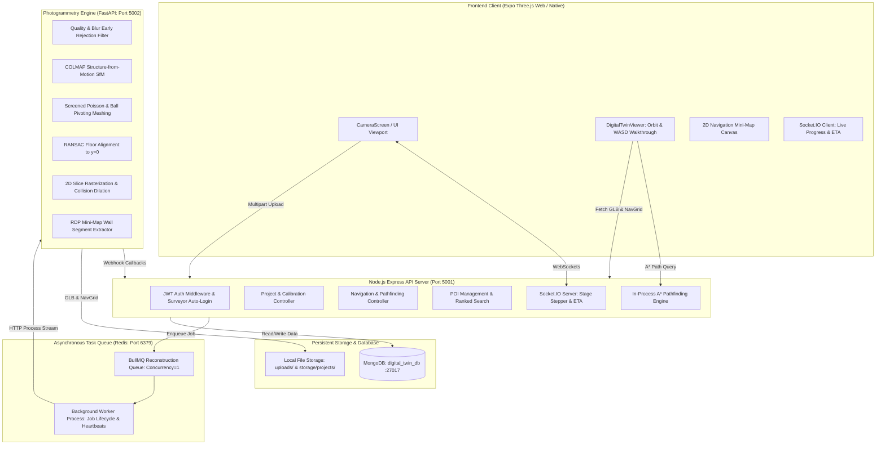

# Namma Space — Architecture & System Design

Namma Space is an end-to-end autonomous 3D digital twin platform that transforms real-world smartphone camera video into photogrammetric, metric-scaled, navigable 3D virtual environments with spatial search, POI annotations, and walking pathfinding.

---

## 1. High-Level System Architecture



---

## 2. Core Subsystems

### 2.1 Video Ingestion & Validation
- **Upload Endpoint**: `POST /api/projects/:id/upload`.
- **Validation**:
  - `ffprobe` inspects video stream: verifies codec, minimum resolution ($\ge 160\times 120$), and maximum duration ($\le 180$ seconds).
  - Sanitized file destination: `uploads/<projectId>/source/video.mp4`.

### 2.2 Python Photogrammetry Engine (`python-service`)
- **Early Rejection Pre-checks**:
  - Computes brightness, Laplacian blur variance ($\ge 30$), SIFT keypoint count ($\ge 100$), and optical motion score ($\ge 0.05$).
  - Fast rejection before COLMAP saves CPU and host memory.
- **COLMAP SfM**:
  - CPU multi-threading (`colmap feature_extractor`, `exhaustive_matcher`, `mapper`).
- **Surface Meshing & Alignment**:
  - Open3D Screened Poisson Surface Reconstruction (depth=8) with Ball Pivoting fallback.
  - KD-tree color transfer from sparse point cloud to mesh vertices.
  - **RANSAC Floor-Plane Fitting**: Fits floor plane equation $ax + by + cz + d = 0$, rotates normal to $+Y$ (up), translates floor to $y=0$, and centers model in $X$ and $Z$.
  - Slices geometry between $0.2\text{m}$ and $1.6\text{m}$ above floor, rasterizes to 5cm grid cells, and dilates by agent radius ($0.25\text{m}$).
  - Extracts 2D wall line segments using OpenCV contour extraction and Ramer-Douglas-Peucker (RDP) polygon simplification.
  - Saves `storage/projects/<id>/final/scene.glb` and `storage/projects/<id>/navigation/navgrid.json`.

### 2.3 Navigation & In-Process Pathfinding (`src/services/navigation.service.js`)
- Runs in-process in Node.js for sub-5ms path queries without Python dependencies.
- **Algorithm**:
  - 8-connected A* search with octile heuristic.
  - Diagonal corner-cutting prevention.
  - String-pulling (Bresenham line-of-sight) path smoothing to eliminate zigzag artifacts.
  - Automatic snapping: snaps coordinates inside obstacles to nearest walkable cell within 2m.
  - Metric scaling: multiplies unit distance by project's calibrated `metersPerUnit`.
  - Walking ETA calculation: assuming $1.3\text{ m/s}$ average human walking speed.

### 2.4 Points of Interest (POIs) & Spatial Search (`src/models/POI.js`)
- **Schema**: `{ projectId, name, category, description, tags, position: {x,y,z}, navPoint: {x,y,z}, createdBy }`.
- **Text Index**: Compound weighted text index on `{ name: 10, tags: 5, description: 2 }`.
- **Fallback**: Case-insensitive regex fallback for partial prefix matches.
- **Automatic Snapping**: On creation/update, snaps `navPoint` to the nearest walkable navigation cell.

### 2.5 Frontend 3D Viewer (`DigitalTwinViewer.web.js`)
- **Three.js WebGL Engine**: ACES Filmic tone mapping, double-sided materials, soft shadow maps.
- **Dual Navigation Modes**:
  - **Orbit Mode**: Orbital rotation, smooth inertia, zoom, pan.
  - **First-Person Walkthrough**: WASD movement with mouselook, eye-level fixed at $y=1.6\text{m}$, constrained by `navGrid` collision detection.
- **2D Mini-Map Radar**: Floating HTML5 canvas rendering wall segments, camera position, directional heading cone, POIs, and glowing route line.
- **Route Visualization**: Glowing 3D green polyline with animated traveling particle beacon.
- **Metric Scale Calibration**: Interactive 2-point measurement modal with door-height fallback.
- **Memory Safety**: Traverses and disposes all geometries, materials, and textures on unmount.

---

## 3. Storage Directory Layout

```
storage/
└── projects/
    └── <projectId>/
        ├── final/
        │   └── scene.glb           # Exported photogrammetric 3D digital twin
        ├── preview/
        │   └── thumbnail.jpg       # Representative thumbnail keyframe
        └── navigation/
            └── navgrid.json        # 2D occupancy raster, wall segments, bounds
```
